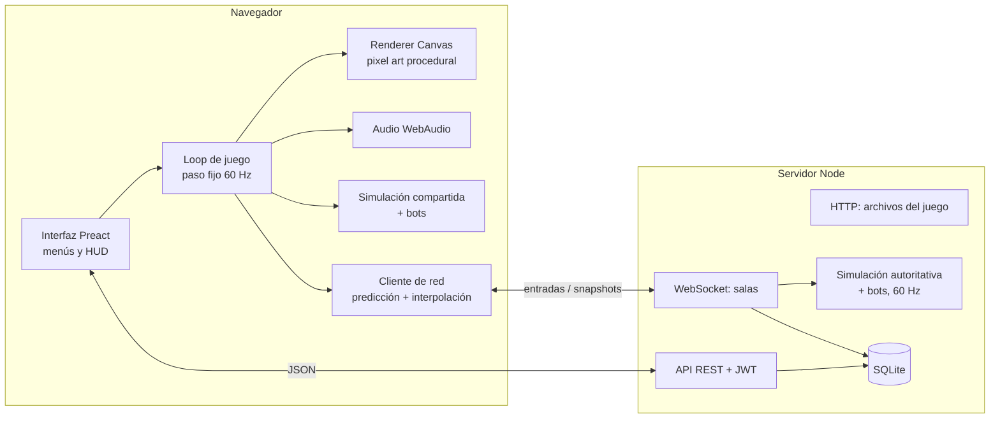
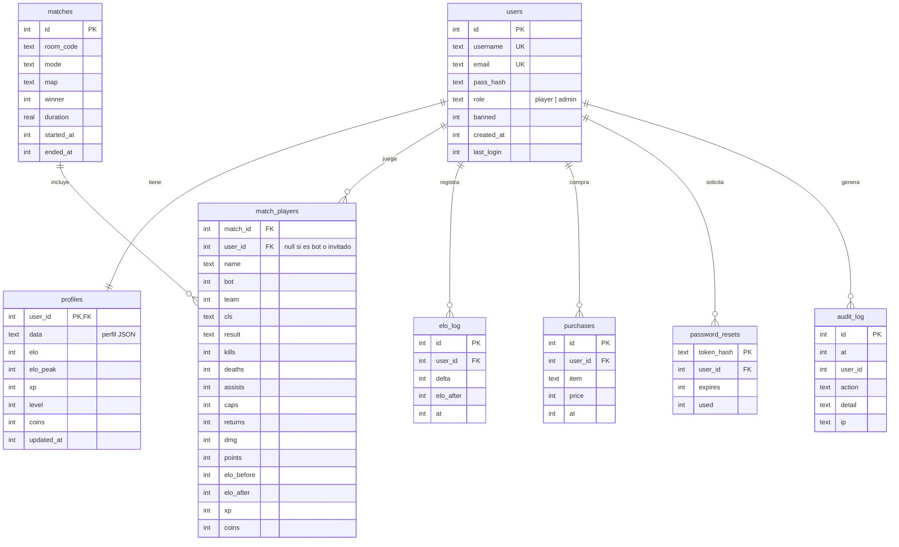

# Arquitectura

## Visión general

La regla principal es **una sola simulación**: `src/shared/sim.ts` es código puro, sin gráficos ni red. La usa:

- el **navegador**, para partidas contra bots, 2 jugadores locales, el Festival y el tutorial (funciona sin internet);
- el **servidor**, para las partidas online, donde es la autoridad: el cliente solo manda teclas y nadie puede modificar su puntaje.

## Simulación (`src/shared`)

| Archivo | Responsabilidad |
|---|---|
| `types.ts` | Estado de la partida como datos planos (serializables) |
| `sim.ts` | Paso de simulación: movimiento en grilla con ayuda en esquinas, bombas y cadenas, llamas, ataques, proyectiles, Hipercargas, zonas, barreras, mejoras, banderas, compuertas, lava, regeneración de bloques, modos, rondas, muerte súbita y tutorial |
| `ai.ts` | Bots: mapa de peligro (cuándo explotará cada casilla, contando cadenas), Dijkstra con costo extra por bloques, roles por clase (atacante, escolta, defensor, medio campo), posiciones de tiro, uso de bombas con escape verificado y uso de Hipercarga según la situación |
| `balance.ts` | Números del juego, progresión, economía y ELO |
| `maps.ts` | Mapas en texto (se escribe la mitad y se refleja) |
| `profile.ts` | Perfil, logros y la regla que aplica el resultado de una partida (misma en cliente y servidor) |
| `catalog.ts` | Cosméticos y precios (el servidor valida las compras con esta misma tabla) |
| `protocol.ts` | Mensajes WebSocket y snapshots compactos |

La simulación es **determinista** con la misma semilla y las mismas entradas (hay un test que lo verifica).

## Cliente (`src/client`)

- **Arte procedural** (`gfx/`): `PixelCanvas` dibuja primitivas píxel a píxel (elipses sombreadas, cajas con volumen, polígonos) y agrega un contorno automático estilo cartoon. Cada personaje tiene una función de dibujo que recibe una *pose* (quieto, caminar, ataque, Hipercarga, daño, KO, festejo) en 4 direcciones. Los cuadros se generan la primera vez que se usan y quedan en caché. Las skins son paletas alternativas.
- **Renderer** (`render/`): dibuja en una resolución interna entera (×1 a ×4) para que el pixel art se vea nítido y lo escala al tamaño de la pantalla. Ordena por fila (vista 3/4), interpola entre ticks, sacude la cámara y maneja las partículas, los números de daño y los efectos de cada evento.
- **Loop** (`game/`): paso fijo de 60 Hz con acumulador. Entradas de teclado (la última dirección presionada manda), mando (Gamepad API) y controles táctiles.
- **Online** (`game/net.ts`):
  - El cliente manda una entrada por tick, con número de secuencia.
  - El servidor procesa una por tick y en cada snapshot confirma la última que procesó (`ack`).
  - **Predicción:** el jugador propio se mueve al instante en el cliente. Cuando llega un snapshot, se parte de la posición del servidor y se reaplican las entradas todavía no confirmadas (reconciliación).
  - **Interpolación:** el resto de los jugadores se dibuja interpolado entre los dos últimos snapshots (llegan 20 por segundo).
- **UI** (`ui/`): Preact con una pila de pantallas simple y HUD en HTML sobre el canvas.
- **Servicios**: perfil local (localStorage) o remoto (API), ajustes y detección del servidor.

## Servidor (`server`)

| Archivo | Responsabilidad |
|---|---|
| `index.ts` | HTTP (sirve `dist/` con cabeceras de seguridad y CSP), API, WebSocket, heartbeat y apagado ordenado |
| `api.ts` | Endpoints REST ([ver API](api.md)) |
| `rooms.ts` | Salas, partida rápida, lobby con chat, loop de 60 Hz, snapshots de 20 Hz, reemplazo por bot al desconectarse, reconexión, resultados y ELO |
| `db.ts` | Esquema SQLite y consultas |
| `security.ts` | scrypt, JWT HS256, límite de peticiones, validaciones y filtro de chat |
| `log.ts` | Logs en JSON (consola y archivo opcional) |

### Base de datos (DER)

- **Índices:** `profiles(elo)`, `profiles(elo_peak)`, `matches(ended_at)`, `match_players(user_id)`, `match_players(match_id)`, `elo_log(at, user_id)` y `audit_log(at)`.
- **Integridad:** claves foráneas activas, `ON DELETE CASCADE` en los datos del usuario y `SET NULL` en el historial de partidas (así se conservan las estadísticas).
- **Respaldo:** la base es un único archivo (`DB_PATH`). Con modo WAL alcanza con copiar el archivo o usar `sqlite3 bomberman.db ".backup respaldo.db"` (por ejemplo, con un cron diario).

## Seguridad

| Riesgo | Medida |
|---|---|
| Contraseñas robadas | scrypt con sal aleatoria de 16 bytes; nunca se guardan ni se registran en texto plano |
| Sesiones falsificadas | JWT HS256 firmado con `JWT_SECRET`, con vencimiento de 7 días; se revisa la firma, el vencimiento y que el usuario exista y no esté suspendido |
| Acceso indebido | Roles `player` y `admin`: las rutas `/api/admin/*` exigen admin y un admin no puede modificar su propia cuenta |
| Fuerza bruta | Límites de peticiones: 10 por minuto en autenticación, 120 en ráfaga en la API y 120 mensajes por segundo en el WebSocket |
| Trampas | El servidor online es autoritativo. Los resultados offline de cuentas se validan: topes según la duración, límite de envíos y recompensas con máximo. Las compras se validan en el servidor |
| Enumeración de cuentas | La recuperación de contraseña responde lo mismo exista o no el email; el código se guarda hasheado y dura 30 minutos, de un solo uso |
| Inyección SQL | Solo consultas preparadas con parámetros |
| XSS | La UI no inserta HTML sin escapar y el texto libre se limpia. CSP: `default-src 'self'` |
| Peticiones enormes | Cuerpo máximo de 64 KB y mensajes WebSocket de 8 KB |
| Auditoría | `audit_log` registra registros, ingresos (también los fallidos), compras, recuperaciones y acciones de administración |

## Rendimiento

Números medidos en la máquina de desarrollo:

- **Simulación:** una partida de 5 minutos con 6 bots se simula en ~1 s de CPU (~0,3% del tiempo real), así que un servidor chico puede correr muchas salas a la vez.
- **Red:** unos 2 a 3 KB por snapshot a 20 Hz, alrededor de 50 KB/s por jugador.
- **Cliente:** 60 FPS en notebooks comunes; el piso se dibuja en caché y los sprites se generan solo la primera vez.
